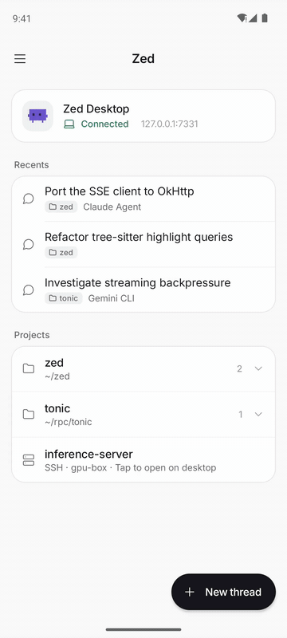

# Zed Mobile (Android)

Zed Mobile is a focused Android companion for the local `Zed-Desktop` fork. On a private Tailscale network it lets you choose an open or recently used local project, continue a Zed Agent or external agent thread (such as Claude Agent, Gemini CLI, or Codex), send prompts, see retained agent activity, answer tool approvals with any option desktop offers, answer the Agent's questions, adjust a thread's model/thinking configuration or an external agent's own modes and options, review diffs and keep or reject the Agent's edits, and receive direct live task-completion notifications.

It intentionally does **not** expose a general filesystem, terminal, shell, or remote desktop interface.

<p align="center">
  
</p>

<p align="center"><sub>Starting a thread, answering the Agent's question, approving <code>cargo test</code>, and keeping the edits (2× speed).</sub></p>

## Pairing and security

- Pairing is QR-first. In Zed-Desktop open **Settings → Mobile Gateway → Connect mobile device**, then scan the time-limited QR code from this app.
- The QR contains a short-lived, one-time pairing ticket—not a long-lived gateway credential or legacy shared token.
- After a successful claim, Android stores the device credential as AES-GCM ciphertext in DataStore. The key is non-exportable and held in Android Keystore.
- Zed-Desktop persists only the device ID, label, timestamp, and SHA-256 credential hash. It lists paired devices under **Settings → Mobile Gateway**, where removing a device immediately revokes access.
- The app prevents screenshots with `FLAG_SECURE` and disables Android backups. Credentials are never added to `SavedStateHandle`, logs, or UI state.
- HTTPS uses Android certificate validation. Direct HTTP is accepted only for loopback, a literal Tailscale IPv4 address (`100.64.0.0/10`), or debug-only emulator `10.0.2.2`. Hostnames, LAN/public HTTP addresses, URL paths, URL credentials, queries, fragments, redirects, and non-default HTTP encodings are rejected.
- Google Code Scanner runs in Google Play services, so the app intentionally declares **no** `CAMERA` permission.

For v2 QR pairings, **Stay connected for Agent notifications** is enabled by default. While it is enabled, Android runs a low-priority foreground service that holds a direct authenticated SSE connection to the paired desktop and posts generic Agent completion notifications. Android 13+ asks for notification permission when the connection is enabled. SSE events are ephemeral: the app neither saves event IDs nor asks the desktop to replay anything missed while the phone was offline.

The latest authenticated v2 project catalog is cached locally only to make launch responsive. It is bound to the saved desktop origin and device ID, never grants access, and is discarded when that credential binding is removed or changes. If the desktop is unavailable, the app labels the catalog as last-known data and disables project actions until a fresh desktop request succeeds.

## Desktop setup

1. Build/run the `Zed-Desktop` fork from `../zed-desktop` and open the local project(s) you intend to use.
2. Configure an authenticated built-in Agent model/provider.
3. Put the desktop and Android device on the same Tailscale tailnet.
4. In **Settings → Mobile Gateway**, configure:
   - **Bind Address** as the desktop's Tailscale IP and port, for example `100.99.221.90:7331`;
   - **Enabled**. Every currently open local project becomes available to paired phones, recently used local projects can be reopened through the catalog, and phones can answer approvals and questions and keep or reject Agent edits.
5. Choose **Connect mobile device**, open Zed Mobile, and scan the QR code.

The gateway must never be made public through a proxy, port forwarding, or reverse tunnel. The desktop-maintained project catalog is an API-access boundary—not a sandbox for Agent tools—so review tool permissions, model data sharing, and potential provider costs.

## Android flow

```text
Scan desktop QR → Projects → Threads → Agent chat → Changes
```

The warm Material 3 UI is optimized for phone-sized screens. The chat renders user/assistant messages, collapsible thinking blocks, tool output, plans, compaction information, approval cards with every desktop option (including always-rules scoped to command patterns), Agent question forms, and a model/thinking configuration sheet. Older messages load on demand. The Changes page can Keep or Reject edits per file or all at once, undo the last reject, and page through large diffs.

When desktop has external agents configured, **New thread** asks which agent to use. External agents bring their own desktop sign-in and models: sign in once on desktop, and a thread that still needs it shows a notice instead of failing silently. Their settings sheet lists the agent's own options (such as model or permission mode) or modes.

A phone decision always names one of the desktop's own options for the call that is pending now; it cannot invent a rule, alter command input, or approve a stale tool call. The QR ticket expires after two minutes, but the successfully paired device credential persists until you remove the device in Zed-Desktop settings or forget the pairing on the phone.

## Build and test

Open `zed-mobile` in Android Studio with Android SDK Platform 35 installed, or run from a terminal with a configured Android SDK:

```sh
./gradlew test assembleDebug
```

### Screenshots without an emulator

```sh
./gradlew recordRoborazziDebug --tests 'dev.zed.mobile.ScreenshotTest'
```

This renders real app screens from fixed sample states on the JVM (Robolectric + Roborazzi) to `app/build/outputs/roborazzi/`. No emulator, device, or desktop is needed.

The debug APK is created at:

```text
app/build/outputs/apk/debug/app-debug.apk
```

Install it with Android Studio, or with ADB:

```sh
adb install -r app/build/outputs/apk/debug/app-debug.apk
```

### Emulator pairing (debug builds only)

Emulator images without Google Play services cannot run the QR scanner. Debug builds accept the same one-time `ZEDM2:` pairing value as an intent extra; release builds ignore it:

```sh
adb reverse tcp:7331 tcp:7331   # with the desktop gateway bound to 127.0.0.1:7331
adb shell am start -S -n dev.zeddesktop.mobile/dev.zed.mobile.MainActivity --es dev.zed.mobile.DEBUG_PAIRING_QR 'ZEDM2:…'
```

For a real-device test, ensure the phone and desktop are connected to the same tailnet before scanning the desktop QR code. Keep **Stay connected for Agent notifications** enabled in Settings, start or open a native Agent thread from Zed Mobile, background the app, then let that Agent turn finish to verify the generic completion notification. Events are intentionally dropped if the stream is offline; reopening the app later still lets you fetch the completed thread normally.
